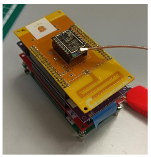
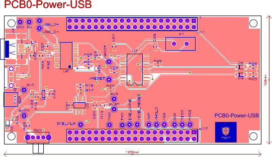
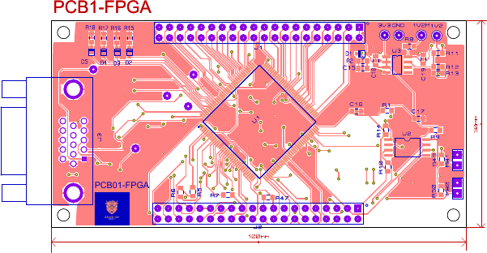
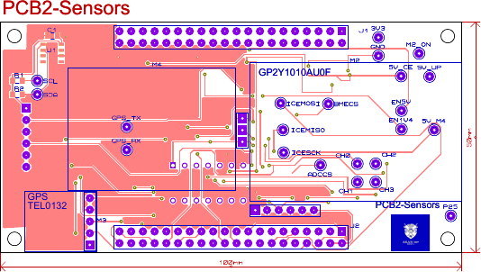
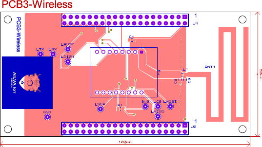
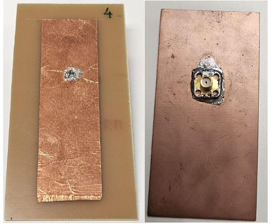
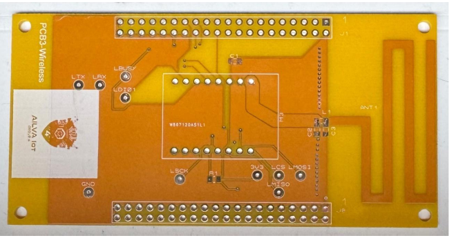

# LoRa telemetry node on an FPGA RISC-V core

Four stacked boards, a soft-core RISC-V running bare-metal C, five environmental sensors and a GPS, and an SX1262 radio sending telemetry frames at 868 MHz to a receiver: a datalogger designed, fabricated, assembled and measured from the ground up.

Taller de Proyectos 1, Master's in Telecommunications Engineering, University of Valladolid, autumn 2025. Group 4: Andrés García Treviño, Iván Herrero Alonso, Lucía López García, Víctor Rueda Domínguez and Alonso Sandoval Martínez.

<p align="center">
  
</p>

## The boards

| board | job | main parts |
| --- | --- | --- |
| PCB0 · Power-USB | powers and programs the stack | USB Mini-B, MCP73831 Li-Po charger, MCP1725 3.3 V regulator with sense resistors for current measurement, CY7C65213 USB-UART bridge, LPC1112 |
| PCB1 · FPGA | runs the system | Lattice iCE40HX4K, configuration flash, 12 MHz crystal, the RISC-V soft core and its peripherals |
| PCB2 · Sensors | reads the world | BME680 (temperature, humidity, pressure, gas), MQ-9 gas sensor, GP2Y1010 dust sensor, TEL0132 GPS, MCP3004 ADC, switched 5 V and 1.4 V rails for the analogue sensors |
| PCB3 · Wireless | talks | LAMBDA62 module (Semtech SX1262), 50 Ω microstrip, matching network, a meander monopole etched on the board, u.FL for an external antenna |

<p align="center">
  
  
</p>
<p align="center">
  
  
</p>

Schematic capture and layout in Proteus; Gerbers for the four boards; BOM with supplier codes (about €73 for PCB0 alone, without VAT); power budget and thermal analysis per rail. Change control and the Gantt are in the repository.

## The digital system

laRVa, a small RISC-V soft core in Verilog, with a memory map built for this board: three UARTs (console, GPS, auxiliary), two SPI masters (sensors and ADC on one, the radio on the other), a timer, GPIO for the sensor power rails, the radio reset and the LoRa `BUSY`/`DIO1` lines, and an interrupt controller with eight vectors. 18 MHz system clock.

The firmware is freestanding C on that core: drivers for the BME680 (with the compensation maths), MCP3004, GP2Y1010 timing, NMEA parsing for the GPS, and an SX1262 driver covering reset, register access, TX and RX, RSSI and SNR, and the frequency, bandwidth and spreading-factor configuration. A UART console menu runs each sensor test, one LoRa transmission, continuous reception, or a telemetry stream.

```
Software/laRVa_lesdoy_G4_Funcional/
├── main.v  system.v  laRVa.v  uart.v  spi.v  timer.v   FPGA top level, SoC, core and peripherals
├── pines.pcf                                           iCE40 pin constraints
├── Firmware/  main.c  BME680.c  MCP3004.c  GP2Y1010.c  GPS_code.c  lora_sx1262.c  SPI.c
└── Makefile                                            sim, bitstream, programming
```

## The radio path

Two antennas were designed, built and measured with a NanoVNA, both simulated in Ansys HFSS:

- a **patch antenna**, 25×85 mm copper on FR-4 over a 50×100 mm ground plane, trimmed on the bench to 868 MHz;
- the **meander monopole** etched on PCB3, simulated six times as the model grew to include the transceiver module and all its pins, then cut back on the real board until it resonated at 868.5 MHz: S11 −24.1 dB, SWR 1.14, 45.7 Ω.

<p align="center">
  
  
</p>

The link itself ran at 14 dBm, BW 125 kHz, SF 9, CR 4/7, interrupt-driven reception on `DIO1`, first between two Arduino-hosted modules to validate the configuration and then from the node. A coverage study (rooftop and street-level transmitter, link budget) sizes the range.

My part: the SE and SC work with the group, the antenna measurements and simulation reviews, and the rooftop coverage calculation; the radio and sensor firmware was shared across the five of us.

## Layout

```
Hardware/           Proteus project, schematic PDF, footprints, Gerbers
Software/           Verilog SoC and firmware
SC/                 antenna projects (HFSS), LoRa Arduino test code, communications report
Control_cambios/    Gantt
TP1_SE_G4_BOM.pdf   bill of materials
TP1_SE_G4_Consumos.xlsx   power budget
docs/images/        figures used here
```

Toolchain: Yosys, nextpnr-ice40 and IceStorm for the bitstream; Icarus Verilog and GTKWave for simulation; `riscv-none-elf-gcc` for the firmware. The Makefiles point at a bundled Windows toolchain; adjust paths on macOS or Linux.
